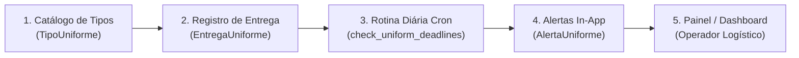
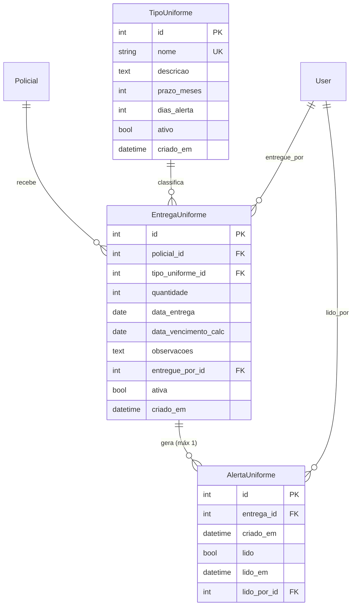

# Módulo de Controle de Uniformes

Sistema de gestão de entrega de fardamento individual e emissão de alertas in-app para renovação periódica no âmbito do **2º BAEP - Seção de Logística**.

---

## 1. Visão Geral

O módulo **Uniformes** gerencia a concessão de fardamentos e equipamentos individuais aos policiais militares, garantindo previsibilidade logística, tempestividade na substituição de itens desgastados e total rastreabilidade das entregas.

### Fluxo Macro de Funcionamento



1. **Catálogo de Tipos**: Cadastro dos itens de fardamento com prazo de validade (meses) e antecedência de alerta (dias).
2. **Registro de Entrega**: Atribuição da peça ao policial militar com cálculo automático da data de vencimento.
3. **Rotina Noturna/Diária**: Comando executado via cron que varre entregas ativas e identifica itens próximos da expiração.
4. **Alertas In-App**: Notificações persistentes no sistema (sem envio de e-mails externos).
5. **Painel Operacional**: Dashboard com indicadores (KPIs), badges de status e controle de leitura.

---

## 2. Modelos de Dados



### Detalhamento dos Modelos

- **`TipoUniforme`**: Catálogo de itens disponíveis (ex: *Calça Tática Ripstop*, *Coturno Operacional*, *Gandola Tática*). Armazena o ciclo de vida útil em meses (`prazo_meses`) e a margem de antecedência para alerta (`dias_alerta`). Possui histórico de auditoria (`simple_history`).
- **`EntregaUniforme`**: Registro do fardamento entregue a um policial. Calcula a `data_vencimento_calc` automaticamente no `save()`. Possui auditoria via `simple_history`.
- **`AlertaUniforme`**: Notificação in-app gerada automaticamente pelo sistema quando a entrega atinge a janela de vencimento. Possui controle de leitura com data (`lido_em`) e usuário (`lido_por`).

---

## 3. Regras de Negócio

### 3.1. Cálculo Automático de Vencimento
- O vencimento é calculado no método `save()` do modelo `EntregaUniforme`:
  $$\text{data\_vencimento\_calc} = \text{data\_entrega} + \text{relativedelta}(\text{months}=\text{prazo\_meses})$$
- O uso de `relativedelta` assegura conformidade com o calendário civil e meses de durações variáveis (ex: entregas em 31 de janeiro com prazo de 1 mês vencem em 28 de fevereiro).
- O campo `data_vencimento_calc` é gravado com `editable=False` para garantir consistência.

### 3.2. Janela de Alerta
- Cada tipo de uniforme define seus `dias_alerta` (padrão: 30 dias).
- A entrega entra na janela de alerta quando:
  $$\text{hoje} \ge \text{data\_vencimento\_calc} - \text{dias\_alerta}$$

### 3.3. Idempotência e Política de Alertas (Opção B)
- **1 Alerta por Entrega**: Cada entrega gera no máximo **1 alerta** durante toda a sua existência ativa.
- Uma vez gerado o alerta, mesmo após o operador marcá-lo como lido, novas execuções da rotina **não** recriam o alerta para aquela mesma entrega.
- Não há exclusão física do alerta ao marcar como lido; o registro permanece no banco para fins de auditoria e métricas.

### 3.4. Ciclo de Vida do Registro (`ativa`)
- `ativa=True`: Entrega regular, vigente e monitorada pelo cron.
- `ativa=False`: Usado exclusivamente para **cancelamento administrativo** ou correção de lançamento efetuado por engano.
- **Não utilizar `ativa=False` para devolução ou renovação**: Quando o policial recebe um novo fardamento, cria-se uma **nova entrega**. A anterior permanece com seu ciclo encerrado no histórico.
- Entregas com `ativa=False` são automaticamente desconsideradas pela rotina de alertas.

### 3.5. Impacto de Alterações no Catálogo
- A alteração do campo `prazo_meses` no `TipoUniforme` **NÃO recalcula retroativamente** entregas antigas já registradas. O novo prazo surtirá efeito apenas para novas entregas.

### 3.6. Limitação Conhecida (Fase Atual)
- Se uma entrega já alertada for editada e sua data de entrega for postergada (movendo o vencimento para o futuro), nenhum alerta adicional será gerado quando ela reingressar na janela de alerta, visto que a regra da Opção B impede alertas duplicados por entrega.

---

## 4. Agendamento Cron no Coolify / Servidor

A varredura diária das entregas deve ser executada via comando de gerenciamento Django:

### Comando de Execução
```bash
python manage.py check_uniform_deadlines
```

### Simulação sem Efeito Colateral (`--dry-run`)
```bash
python manage.py check_uniform_deadlines --dry-run
```

### Configuração Recomendada no Coolify (Cron Job)
- **Schedule**: Execução diária às 06:00 da manhã.
- **Expressão Cron**:
  ```cron
  0 6 * * *
  ```
- **Container / Service**: Aplicação web principal (`reserva_baep`).

---

## 5. Permissões de Acesso (RBAC)

O controle de acesso ao módulo segue o padrão centralizado de permissões do sistema (`reserva_baep.decorators.require_module_permission`):

1. **Grupo de Acesso**: Criar o grupo **`uniformes`** no Django Admin (`/admin/auth/group/`).
2. **Atribuição**: Vincular os policiais e operadores da Seção de Logística ao grupo `uniformes`.
3. **Visibilidade**:
   - Administradores (`is_superuser=True`) têm acesso irrestrito.
   - Usuários pertencentes ao grupo `uniformes` visualizam o menu lateral "Uniformes" e o card correspondente no painel de módulos (`modulo_dashboard.html`).
   - Requisições sem permissão são interceptadas retornando `PermissionDenied` (HTTP 403).

---

## 6. Procedimento de Teste Manual

Para validar o funcionamento completo de ponta a ponta:

1. **Cadastrar Tipo de Uniforme**:
   - Acesse `/uniformes/tipos/novo/`
   - Nome: `Coturno Tático de Teste`
   - Prazo: `12` meses | Dias de Alerta: `30`
2. **Registrar Entrega Retroativa**:
   - Acesse `/uniformes/entregas/nova/`
   - Selecione um policial militar e o tipo cadastrado.
   - Defina a data de entrega retroativa (ex: 11 meses e meio atrás, de modo que vença em ~15 dias).
3. **Executar Simulação**:
   ```bash
   python manage.py check_uniform_deadlines --dry-run
   ```
   *Resultado esperado:* Registro identificado com mensagem indicando que criaria 1 alerta.
4. **Executar Rotina Efetiva**:
   ```bash
   python manage.py check_uniform_deadlines
   ```
   *Resultado esperado:* `1 novo(s) alerta(s) criado(s)`.
5. **Verificar no Dashboard**:
   - Acesse `/uniformes/` e confira o card de alertas pendentes e o badge amarelo ("Vencendo em 15d").
   - Acesse `/uniformes/alertas/` e clique em **Marcar como lido**.
6. **Validar Idempotência**:
   ```bash
   python manage.py check_uniform_deadlines
   ```
   *Resultado esperado:* `0 novo(s) alerta(s) criado(s), 1 entrega(s) já alertada(s) mantida(s)`.

---

## 7. Diagnóstico e Resolução de Problemas (Troubleshooting)

| Sintoma | Causa Mais Provável | Ação de Resolução |
| :--- | :--- | :--- |
| **Menu "Uniformes" não aparece na barra lateral** | Usuário não pertence ao grupo `uniformes` nem é superuser. | Incluir o usuário no grupo `uniformes` via Django Admin. |
| **Alerta não foi gerado pelo comando** | A entrega não atingiu a data limite ou está com `ativa=False`. | Verificar se $\text{hoje} \ge \text{vencimento} - \text{dias\_alerta}$ e confirmar se a entrega está ativa. |
| **Alerta não é recriado após leitura** | Comportamento esperado da regra de negócio (Opção B). | Cada entrega gera apenas 1 alerta em seu ciclo de vida. |
| **Data de vencimento calculada incorreta** | O prazo do tipo de uniforme foi alterado após o registro da entrega. | Edições no catálogo não afetam entregas passadas. Se necessário, edite e salve a entrega para forçar o recálculo. |
| **Erro ao tentar excluir entrega** | Integridade relacional via `PROTECT` com auditoria. | O sistema utiliza desativação lógica (`ativa=False`) em vez de exclusão física no banco. |
